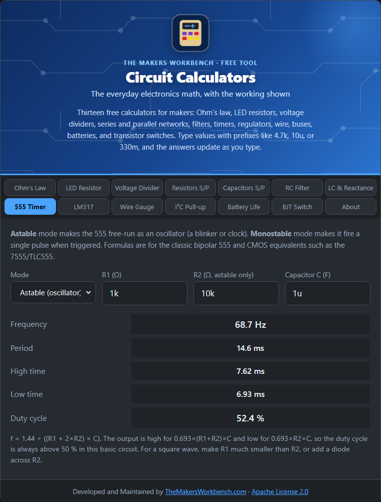

# 555 Timer

The 555 is a small, cheap chip that has been making pulses and delays for fifty years. Two resistors, a capacitor, and the chip give you a blinker, a clock, or a timer.

## The theory

Inside the 555, a capacitor charges through resistors, and two comparators watch its voltage. When it reaches two thirds of the supply, the chip flips and starts discharging it. At one third it flips back. That endless charge and discharge makes an output that switches on and off. The speed depends on R and C, so you choose the timing with part values.

## Astable mode (oscillator)

Astable means "not stable": the output keeps flipping by itself. You use R1 (from supply to the discharge pin), R2 (between discharge and the capacitor), and C.

- **High time** = 0.693 × (R1 + R2) × C
- **Low time** = 0.693 × R2 × C
- **Period** = high + low, so **frequency = 1.44 ÷ ((R1 + 2 × R2) × C)**
- **Duty cycle** = high time ÷ period, as a percentage

In this basic circuit the output is always high longer than low, so the duty cycle is always above 50 %. To get nearer a square wave, make R1 much smaller than R2 (but not below about 1 kΩ), or add a diode across R2.

## Monostable mode (one-shot)

Monostable means "one stable state". The output rests low until a trigger pulse, then goes high for a set time and falls back. One resistor and one capacitor set the time:

**T = 1.1 × R × C**

In monostable mode enter the resistor in the **R1** box (R2 is not used).

## How to use it

1. Choose **Astable** or **Monostable**.
2. Enter **R1**, **R2** (astable only), and **C**.
3. Read the frequency, period, high and low times, and duty cycle (astable), or the pulse length (monostable).

## Worked examples

- **Astable**: R1 = 1 kΩ, R2 = 10 kΩ, C = 1 µF. High 7.6 ms, low 6.9 ms, period 14.6 ms, **frequency about 68.7 Hz**, duty cycle **52.4 %**. That blinks an LED so fast it looks steady, so use a bigger C (such as 100 µF) for a visible blink.
- **Monostable**: R = 10 kΩ and C = 10 µF give a pulse of **110 ms**.

## Things to watch

- These are standard datasheet formulas. Timing capacitors with wide tolerances (electrolytics especially) make real timing drift by 10 to 20 percent.
- The classic bipolar NE555 draws noticeable current. CMOS versions (7555, TLC555) are better for batteries and high frequency.
- In monostable mode, the trigger pulse must be shorter than the output pulse.

