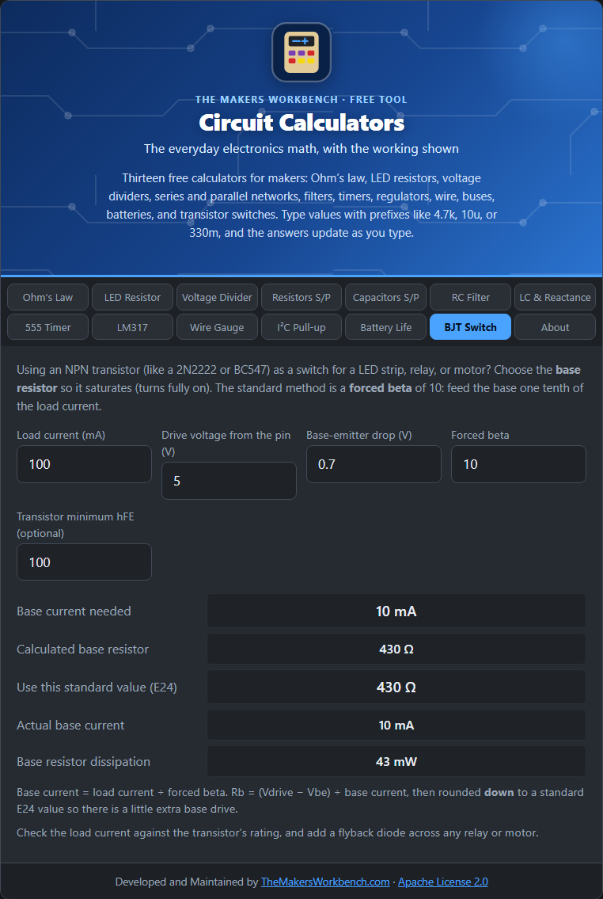

# BJT Switch

A **BJT** (bipolar junction transistor) can switch a load that is too big for a microcontroller pin, such as a relay, a motor, a buzzer, or an LED strip. A small current into the transistor's **base** lets a much larger current flow from collector to emitter. This tab finds the base resistor for an NPN transistor (like a 2N2222 or BC547).

## The theory

A transistor amplifies current: the collector current is roughly the base current times the gain (hFE or beta). When you use it as an amplifier, the collector current follows the base. When you use it as a **switch**, you want it fully on, called **saturation**. A saturated transistor drops very little voltage and wastes little heat.

To be sure the transistor saturates, you push in **more** base current than the gain alone would need. The standard approach is a **forced beta** of 10: supply the base with one tenth of the load current.

**Ib = Ic ÷ forced beta**

The base-emitter junction drops about 0.7 V (Vbe) like a diode, so the resistor sees the drive voltage minus that:

**Rb = (Vdrive − Vbe) ÷ Ib**

The result is rounded **down** to a standard E24 value so there is a little extra base drive, not too little.

## How to use it

1. Enter the **load current** (mA), meaning what the relay, motor, or LED strip draws.
2. Enter the **drive voltage**, the high level at the base resistor (a 5 V or 3.3 V pin).
3. Leave **Vbe** at 0.7 V unless your datasheet says otherwise.
4. Leave the **forced beta** at 10 (use a lower number for more margin).
5. Optionally enter the transistor's **minimum hFE** from its datasheet, so the tool can check it.

## Reading the results

You get the base current, the calculated base resistor, the standard E24 value to use, the real base current with that value, and the resistor's dissipation. If the transistor's minimum hFE is lower than the forced beta, the tool warns you that it may not saturate.

## Step by step

Open the **BJT Switch** tab. It opens with a 100 mA load from a 5 V pin.

1. In **Load current (mA)**, type the current the load draws, for example `100`. Check it on the load's datasheet or measure it.
2. In **Drive voltage from the pin (V)**, type the high-level voltage of the signal that turns it on, for example `5` or `3.3`.
3. In **Base-emitter drop (V)**, leave `0.7`.
4. In **Forced beta**, leave `10`. Use a smaller number such as `5` if you want extra margin.
5. In **Transistor minimum hFE (optional)**, type the minimum gain from the datasheet, for example `100`. If the transistor is too weak, the tool shows a warning.
6. Read **Use this standard value (E24)**. Put that resistor between your pin and the transistor's base.
7. Check **Base current needed** against what your pin can supply (often 20 mA at most). If it is too much, use a transistor with higher gain, a lower forced beta, or a MOSFET.

## Worked example

Switch a 100 mA load from a 5 V pin. Base current = 100 ÷ 10 = **10 mA**. Rb = (5 − 0.7) ÷ 0.01 = **430 Ω**, which is a standard E24 value. Check the pin can supply 10 mA (see below).

## Things to watch

- **Pin current.** Many microcontroller pins give only 10 to 20 mA. For bigger loads use a lower forced beta, a transistor with higher gain, a Darlington, or a logic-level MOSFET.
- **Inductive loads.** Relays and motors create a voltage spike when switched off. Put a **flyback diode** across them, cathode to the supply side.
- **Ratings.** The load current must be below the transistor's maximum collector current, and heat can matter at larger currents.
- Place the transistor on the **low side** (between the load and ground) and connect the emitter to ground.

