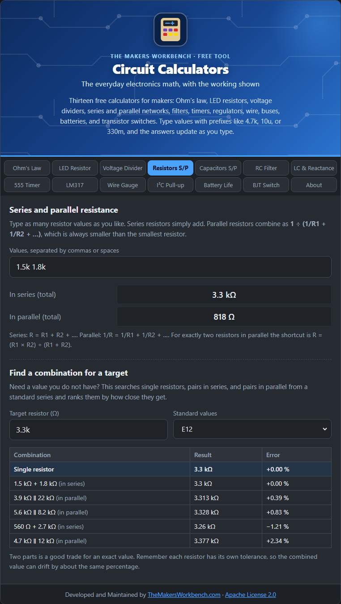
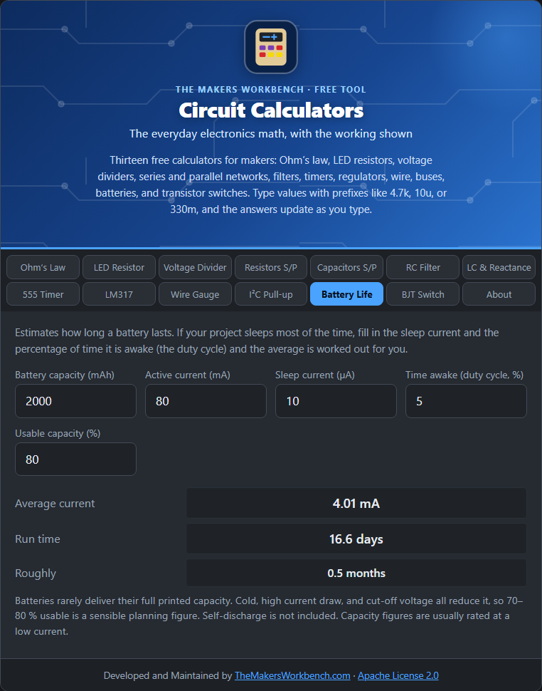

# Calculator Reference

Every tab, what it asks for, and the formula behind it. Sources are listed in [SOURCES.md](https://github.com/MakersWorkbench/circuit-calculators/blob/main/SOURCES.md).

## Ohm's Law

Enter any two of V, I, R, and P. Shows the other two, the smallest resistor rating that works, and the recommended rating (next standard size at least 2x the dissipation).

**Formula:** V = I x R, P = V x I = I²R = V²/R

## LED Resistor

Supply voltage, LED forward voltage, LED current, number of LEDs, series or parallel. Gives the calculated resistor, the next standard value up, the actual current, the resistor power and rating, and draws the circuit.

**Formula:** R = (Vs - n x Vf) / I (series). Parallel uses one resistor per LED.

## Voltage Divider

Input voltage, desired output, a standard series, and the allowed range for R1 + R2. Lists the six closest pairs and details the best: error, divider current, R1 and R2 power, output impedance, and the output with an optional load.

**Formula:** Vout = Vin x R2 / (R1 + R2)

## Resistors S/P

Any number of resistors in series and in parallel, and a search for single resistors or pairs (series or parallel) that best make a target value.

**Formula:** Series: R1 + R2. Parallel: 1 / (1/R1 + 1/R2)

## Capacitors S/P

Any number of capacitors in parallel and in series, and a search for the closest combination to a target capacitance.

**Formula:** Parallel: C1 + C2. Series: 1 / (1/C1 + 1/C2)

## RC Filter

Time constant, cutoff frequency, 10 to 90 % rise time, and charge times.

**Formula:** tau = R x C, fc = 1 / (2 pi R C)

## LC & Reactance

Resonant frequency and characteristic impedance from L and C, and the reactance of a coil or capacitor at a frequency.

**Formula:** f0 = 1 / (2 pi sqrt(LC)), XL = 2 pi f L, XC = 1 / (2 pi f C)

## 555 Timer

Astable: frequency, period, high and low time, duty cycle. Monostable: pulse length.

**Formula:** f = 1.44 / ((R1 + 2 R2) C), T = 1.1 R C

## LM317

Find R2 for a target output, or the output from R1 and R2. Includes the minimum input voltage.

**Formula:** Vout = 1.25 x (1 + R2/R1) + Iadj x R2

## Wire Gauge

AWG size, length, and current. Shows diameter, cross-section, resistance, voltage drop, percent drop of the supply, and power lost.

**Formula:** Diameter = 0.127 mm x 92^((36 - n)/39); copper at 20 C

## I²C Pull-up

Bus supply, speed, and total bus capacitance. Gives the maximum pull-up (rise time), the minimum (sink current), and a suggested E24 value, or tells you when no value works.

**Formula:** Rmax = tr / (0.8473 x Cb), Rmin = (VDD - VOL) / IOL

## Battery Life

Capacity, active current, sleep current, duty cycle, and usable fraction. Gives average current and run time.

**Formula:** Average = active x duty + sleep x (1 - duty)

## BJT Switch

Load current, drive voltage, Vbe, forced beta, and optional hFE. Gives the base current and the base resistor, and warns when the transistor may not saturate.

**Formula:** Ib = Ic / forced beta, Rb = (Vdrive - Vbe) / Ib

