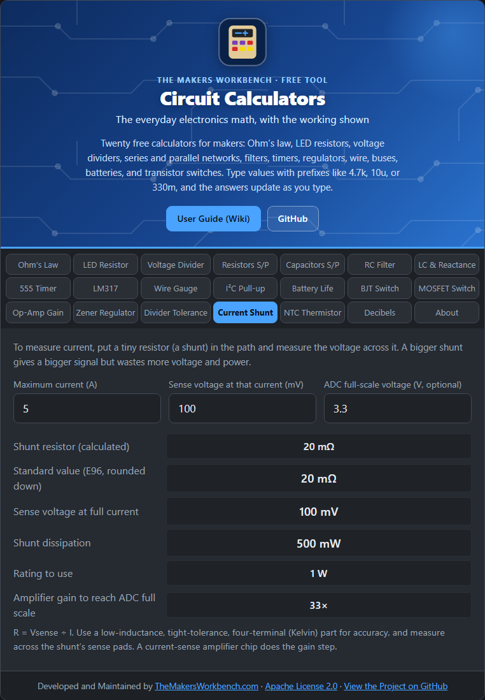

# Current Shunt

To measure a current, put a very small resistor (a **shunt**) in its path and measure the voltage across it. By Ohm's law, that voltage tells you the current: **I = V ÷ R**.

## The theory

A shunt is a trade-off:

- A **bigger** resistor gives a larger, easier-to-measure voltage.
- A **smaller** resistor wastes less voltage and power in the circuit you are measuring.

You choose the voltage you can tolerate at full current (often 50 to 200 mV), then **R = Vsense ÷ Imax**. The shunt's heat is **I² × R**. If your measuring ADC reads 0 to 3.3 V, an amplifier (a current-sense amplifier or op-amp) must multiply the small shunt voltage up. The gain needed is **ADC full scale ÷ Vsense**.

## Step by step

1. Open the **Current Shunt** tab.
2. In **Maximum current (A)**, type the most current you will measure, for example `5`.
3. In **Sense voltage at that current (mV)**, type the voltage you will accept across the shunt, for example `100`.
4. In **ADC full-scale voltage (V, optional)**, type your ADC's range, for example `3.3`, to see the amplifier gain.
5. Read **Standard value (E96, rounded down)**, **Sense voltage at full current**, **Shunt dissipation**, and **Rating to use**.

## Worked example

5 A with 100 mV sensed needs **20 mΩ**. It dissipates **0.5 W**, so use at least a **1 W** part. To bring 100 mV up to a 3.3 V ADC range you need a gain of **33**.

## Things to watch

- At milliohm values, the resistance of your solder joints and traces matters. Use a four-terminal (Kelvin) shunt and measure at its sense pads.
- Use a low-inductance, tight-tolerance, low-temperature-coefficient part for accuracy.
- A shunt in the **ground** path (low side) is simple but lifts the ground reference. A high-side shunt needs a differential or current-sense amplifier.

