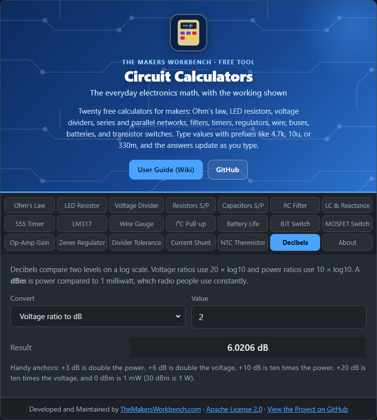

# Decibels

A **decibel** (dB) compares two levels on a **logarithmic** scale. It is how audio, radio, and amplifier gains are described, because the numbers stay small even when the ratios are huge.

## The theory

- **Power ratio**: dB = 10 × log10(P2 ÷ P1)
- **Voltage (or current) ratio**: dB = 20 × log10(V2 ÷ V1). It is 20, not 10, because power goes with the **square** of voltage.
- **dBm**: power compared with 1 milliwatt, **dBm = 10 × log10(P ÷ 1 mW)**. So 0 dBm is 1 mW, 30 dBm is 1 W, and −30 dBm is 1 µW.

Anchors worth remembering: **+3 dB** doubles power, **+6 dB** doubles voltage, **+10 dB** is ten times the power, **+20 dB** is ten times the voltage, and **−3 dB** is half power (the filter cutoff point).

## Step by step

1. Open the **Decibels** tab.
2. In **Convert**, choose the conversion you want, for example **Voltage ratio to dB**.
3. In **Value**, type the number, for example `2`.
4. Read **Result**.

## Worked examples

- A voltage gain of 2 is **6.02 dB**. A power gain of 2 is **3.01 dB**.
- **20 dB** is a voltage ratio of **10**.
- **30 dBm** is **1 W**, and **0 dBm** is **1 mW**.

## Things to watch

- Keep voltage and power straight: using the power formula on voltages gives half the true dB.
- dB values add when stages are chained: a 20 dB amplifier followed by a 6 dB attenuator is 14 dB overall.

