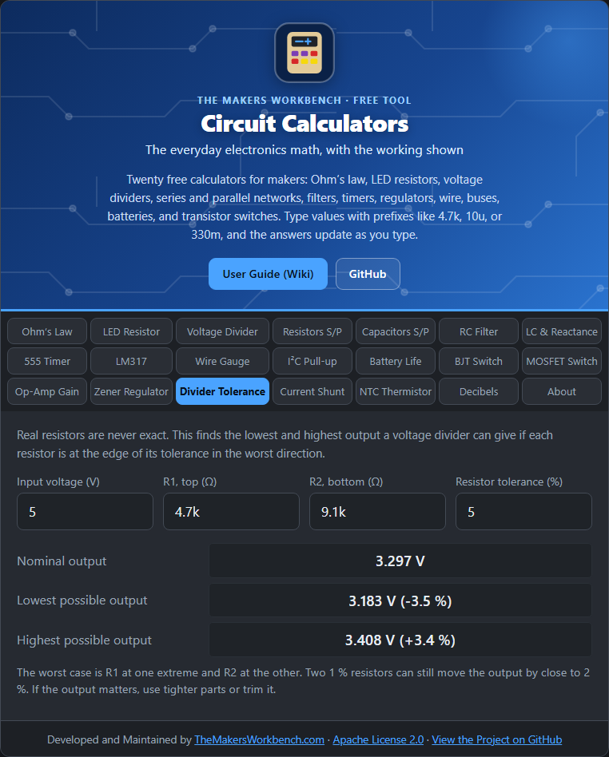

# Divider Tolerance

The [Voltage Divider](Voltage-Divider) calculator treats resistors as exact. Real resistors are not. This tab shows the range of outputs you can actually get.

## The theory

A resistor labeled 5 % can be anywhere from 5 % low to 5 % high. In a divider, the output is **Vout = Vin × R2 ÷ (R1 + R2)**. The extremes occur when the two resistors are off in opposite directions:

- **Highest output**: R2 at its maximum and R1 at its minimum.
- **Lowest output**: R2 at its minimum and R1 at its maximum.

For two equal 1 % resistors, the output can be about **1 %** off in either direction, and for two 5 % resistors about **5 %**. With very unequal resistors the error is a little different, which is why the tool calculates it.

## Step by step

1. Open the **Divider Tolerance** tab.
2. In **Input voltage (V)**, type the supply, for example `5`.
3. In **R1, top** and **R2, bottom**, type the resistors you chose, for example `4.7k` and `9.1k`.
4. In **Resistor tolerance (%)**, type `1`, `2`, `5`, or `10` to match the parts.
5. Read **Nominal output**, **Lowest possible output**, and **Highest possible output**, each with its percent difference.

## Worked example

5 V, R1 = 4.7 kΩ, R2 = 9.1 kΩ, both 5 %: nominal **3.297 V**, lowest **3.183 V (−3.5 %)**, highest **3.408 V (+3.4 %)**. If your 3.3 V device tolerates 3.0 to 3.6 V, that is fine. If you need better accuracy, switch to 1 % resistors and watch it shrink to about 0.7 %.

## Things to watch

- This covers resistor tolerance only. Temperature drift, the input voltage tolerance, and loading from whatever the divider feeds all add to the error.
- For high accuracy, use a matched resistor network, which tracks together and cancels much of the error.

