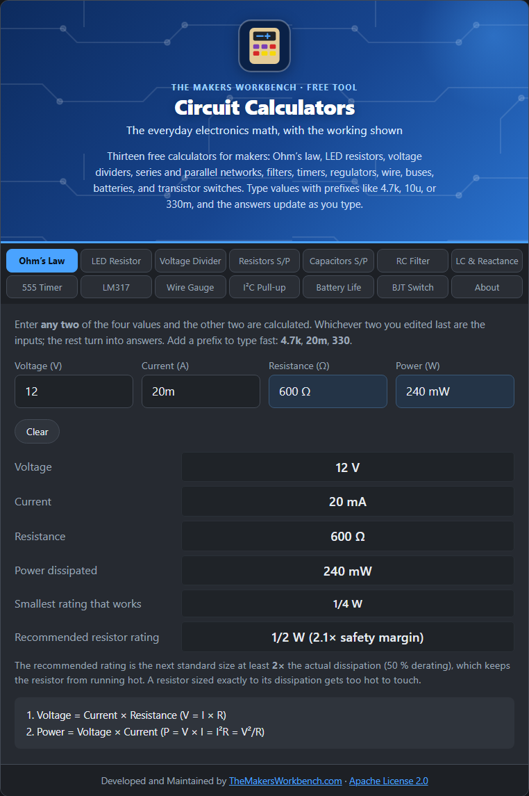

# Circuit Calculators

Free electronics calculators for makers, by [TheMakersWorkbench.com](https://www.themakersworkbench.com). Thirteen tabs, one page, nothing to install.

## Start here

- [Using the Calculators](Using-the-Calculators): typing values, prefixes, and how the answers update
- [Calculator Reference](Calculator-Reference): the full list, one page per calculator
- [Standard Values (E-Series)](Standard-Values-E-Series): why resistors come in odd values

## The calculators

Each page explains the theory, gives the formulas, shows how to use the tab step by step, and walks through a worked example.

- [Ohm's Law and Power](Ohms-Law-and-Power)
- [LED Resistor](LED-Resistor)
- [Voltage Divider](Voltage-Divider)
- [Series and Parallel Resistors](Series-and-Parallel-Resistors)
- [Series and Parallel Capacitors](Series-and-Parallel-Capacitors)
- [RC Filter](RC-Filter)
- [LC Resonance and Reactance](LC-Resonance-and-Reactance)
- [555 Timer](555-Timer)
- [LM317 Regulator](LM317-Regulator)
- [Wire Gauge and Voltage Drop](Wire-Gauge-and-Voltage-Drop)
- [I²C Pull-up Resistors](I2C-Pull-up-Resistors)
- [Battery Life](Battery-Life)
- [BJT Switch](BJT-Switch)

## For developers

- [Embedding](Embedding): add the tool to your own page, including the Drupal module
- [Accuracy and Limits](Accuracy-and-Limits): what the numbers do and do not tell you

## Quick links

- [Source code and issues](https://github.com/MakersWorkbench/circuit-calculators)
- [SOURCES.md](https://github.com/MakersWorkbench/circuit-calculators/blob/main/SOURCES.md): where each formula comes from
- License: [Apache 2.0](https://github.com/MakersWorkbench/circuit-calculators/blob/main/LICENSE)
