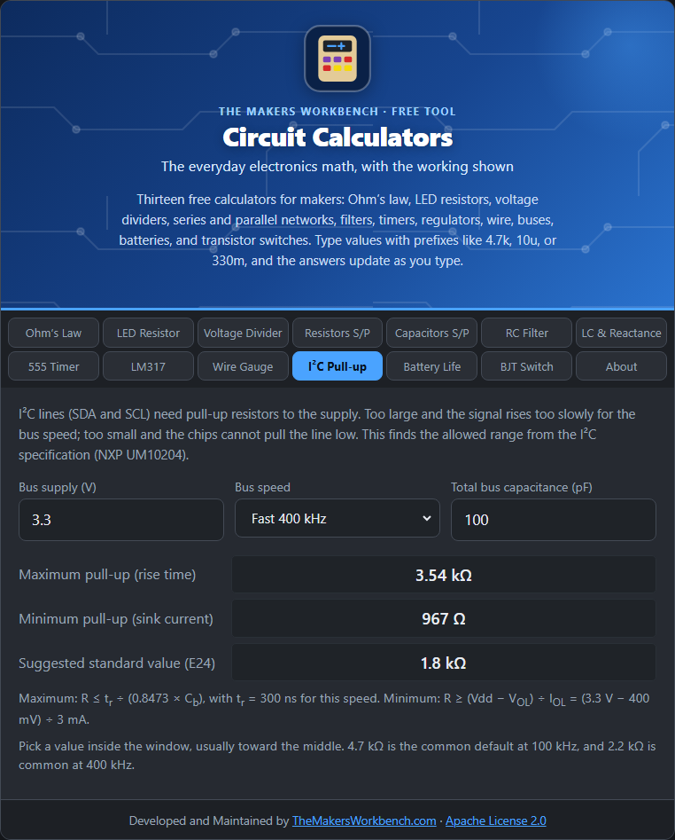

# I²C Pull-up Resistors

I²C (Inter-Integrated Circuit, "I-squared-C") is a two-wire bus many sensors and displays use. The two lines, SDA (data) and SCL (clock), need pull-up resistors, and choosing them is the part many beginners guess at.

## The theory

I²C devices can only pull a line **low**. They cannot push it high. A resistor to the supply (a pull-up) pulls the line high whenever nobody is pulling it low. The value is a trade-off between two limits:

**Too big, and the signal is too slow.** The resistor and the bus's capacitance (the wiring and every chip's pin) form an RC circuit, so the line rises like a capacitor charging. The I²C specification measures rise time from 30 % to 70 % of the supply, which takes 0.8473 × R × C. It must be shorter than the limit for your bus speed:

**Rmax = tr ÷ (0.8473 × Cb)**

**Too small, and chips cannot pull the line low.** Each chip can only sink a limited current. With the resistor connected to the supply, the current to sink is about (VDD − VOL) ÷ R, and the line must be driven below VOL (0.4 V). So:

**Rmin = (VDD − VOL) ÷ IOL**

The limits from the NXP I²C specification (UM10204):

| Mode | Speed | Max rise time | Max bus capacitance | Sink current |
| --- | --- | --- | --- | --- |
| Standard | 100 kHz | 1000 ns | 400 pF | 3 mA |
| Fast | 400 kHz | 300 ns | 400 pF | 3 mA |
| Fast-mode Plus | 1 MHz | 120 ns | 550 pF | 20 mA |

## How to use it

1. Enter the **bus supply voltage** (3.3 V or 5 V).
2. Choose the **bus speed**.
3. Enter the **total bus capacitance** in pF. As a guess, count 10 to 20 pF per device plus about 1 pF per cm of wire. Longer cables add much more.

## Reading the results

You get the **maximum** and **minimum** pull-up value and, when the window is open, a **suggested E24 value** near the middle. If the window is closed (the minimum is bigger than the maximum), the tool says no value works. Then reduce the bus capacitance (shorter wires, fewer devices), slow the bus down, or add an I²C buffer.

## Worked example

3.3 V, Fast mode (400 kHz), 100 pF. The maximum is **3.54 kΩ** and the minimum is **967 Ω**. The tool suggests **1.8 kΩ**. For 100 kHz the usual 4.7 kΩ is common, and 2.2 kΩ is common at 400 kHz.

## Things to watch

- Pull-ups go on the bus **once**, not at every device. Many breakout boards include their own, and several in parallel lower the combined value. If you chain boards, check the total.
- The 0.4 V low level is for supplies above 2 V. At 2 V or below the spec uses 0.2 × VDD, which the calculator applies.
- Fast-mode Plus needs devices that can sink 20 mA on SDA and SCL. Check the datasheets.

