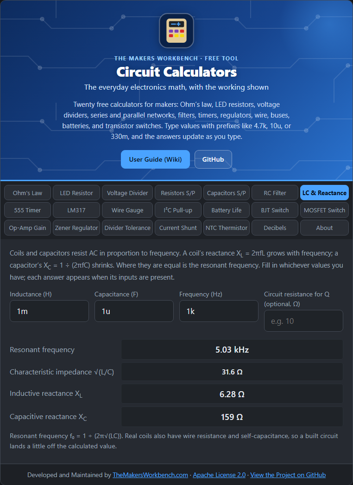

# LC Resonance and Reactance

Coils (inductors) and capacitors respond to AC in opposite ways, and at one special frequency they cancel. That is the principle behind radio tuners, filters, and oscillators.

## The theory

Resistance opposes current the same at any frequency. Coils and capacitors oppose AC current by an amount that depends on frequency, called **reactance** (in ohms, like resistance).

- A **coil** resists changes in current. The faster the signal, the more it resists: **XL = 2π × f × L**. At DC it is a wire; at high frequency it is nearly a block.
- A **capacitor** passes fast changes and blocks slow ones: **XC = 1 ÷ (2π × f × C)**. At DC it blocks; at high frequency it is nearly a wire.

L is inductance in henries (H), C is capacitance in farads (F), and f is frequency in hertz (Hz).

XL rises with frequency and XC falls. They are equal at the **resonant frequency**:

**f0 = 1 ÷ (2π × √(L × C))**

At resonance, a series LC circuit passes the signal easily, and a parallel LC circuit blocks it. The **characteristic impedance** √(L ÷ C) is a useful measure of the circuit's "size" in ohms.

## How to use it

Fill in whichever values you have:

- **L and C** give the resonant frequency and characteristic impedance.
- **f and L** give the coil's reactance at that frequency.
- **f and C** give the capacitor's reactance at that frequency.

Each answer appears when its inputs are there.

## Step by step

Open the **LC & Reactance** tab. It opens with 1 mH, 1 µF, and 1 kHz.

**To find the frequency a coil and capacitor resonate at:**

1. In **Inductance (H)**, type the coil value, for example `1m` for 1 mH or `10u` for 10 µH.
2. In **Capacitance (F)**, type the capacitor, for example `1u` or `100n`.
3. Read **Resonant frequency**. You can ignore the Frequency box for this.

**To find how much a coil or capacitor resists AC at one frequency:**

1. In **Frequency (Hz)**, type the frequency, for example `1k` or `455k`.
2. Type either the **Inductance** or the **Capacitance** (or both).
3. Read **Inductive reactance** (for the coil) or **Capacitive reactance** (for the capacitor). Each one only appears when you have filled in the matching value.

**To design a tuner:** pick a target frequency, then adjust L and C until **Resonant frequency** matches it.

## Q and bandwidth (optional)

Fill in **Circuit resistance for Q (optional)** to find how sharp the resonance is. **Q** (the quality factor) says how selective the circuit is: high Q means a narrow, strong peak, low Q means a broad one. **Bandwidth = f0 ÷ Q**.

- If the resistance is in **series** with the coil and capacitor, **Q = (1 ÷ R) × √(L ÷ C)**.
- If the resistance is **in parallel** across them, **Q = R × √(C ÷ L)**.

The tool shows both, so use the one that matches where your resistance sits. Example: 1 mH and 1 µF with 10 Ω in series gives Q ≈ 3.16 and a bandwidth of about 1.59 kHz around the 5.03 kHz resonance.

## Worked example

L = 1 mH and C = 1 µF resonate at **5.03 kHz** with a characteristic impedance of **31.6 Ω**. At 1 kHz the coil has only **6.28 Ω** of reactance but the capacitor has **159 Ω**. As frequency climbs toward 5 kHz these two meet.

## Things to watch

- Real coils have wire resistance and stray capacitance, and capacitors have stray inductance, so a built circuit resonates a little off the calculated value.
- For a radio tuning circuit, a variable capacitor changes C and so moves f0.
- Resonant circuits can build up large voltages, bigger than the supply. Check component ratings.

