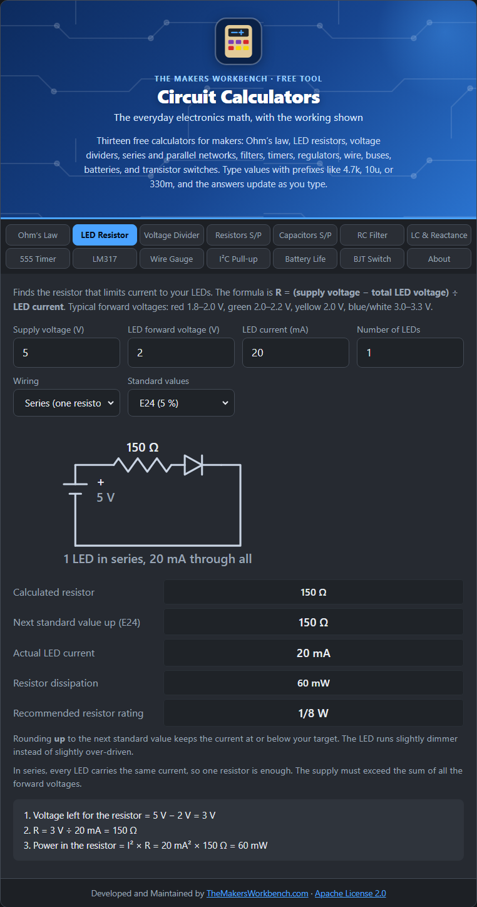

# LED Resistor

An LED is not like a light bulb. Once the supply is high enough, an LED lets current rise very steeply, and too much current destroys it in a moment. The standard fix is a **current-limiting resistor** in series with it.

## The theory

An LED has a **forward voltage** (Vf), the voltage it drops when it is on. Red LEDs are around 1.8 to 2.0 V, yellow and green about 2.0 to 2.2 V, and blue and white about 3.0 to 3.3 V. The exact value is on the datasheet, and it varies a little from one LED to the next.

The resistor has to drop everything the LED does not. By Ohm's law:

**R = (Vs − Vf) ÷ I**

where Vs is the supply voltage and I is the current you want (commonly 10 to 20 mA for a standard 5 mm LED). With several LEDs in a chain, add their forward voltages: **R = (Vs − n × Vf) ÷ I**.

## How to use it

1. Enter the **supply voltage** (the battery or pin voltage that drives the LED).
2. Enter the LED's **forward voltage**.
3. Enter the **current** you want, in mA (type `20` for 20 mA).
4. Enter the **number of LEDs**.
5. Choose the **wiring**: *Series* (one resistor, LEDs in a chain) or *Parallel* (one resistor per LED).
6. Choose a **standard value series** (E24 is a good default; it matches the 5 % resistors most kits contain).

## Reading the results

- **Calculated resistor**: the exact value the formula gives.
- **Next standard value up**: real resistors only come in certain values (see [Standard Values](Standard-Values-E-Series)). The calculator rounds **up**, so the real current is always at or below your target. The LED is a touch dimmer instead of a touch over-driven.
- **Actual LED current**: what flows with that real resistor.
- **Resistor dissipation and rating**: the power the resistor turns into heat, and the standard wattage to buy. Most LED resistors are fine as 1/8 W or 1/4 W.
- The drawn circuit shows how to wire it.

## Series or parallel?

**In series**, the same current flows through every LED, so one resistor does the job. The catch is that the supply must exceed the **sum** of all the forward voltages. Three 2 V red LEDs need more than 6 V, so a 5 V supply cannot run them in series (the calculator tells you so).

**In parallel**, each LED gets its own resistor. It is tempting to share one resistor across several LEDs, but LEDs of the same model still differ slightly in Vf, and the one with the lowest Vf takes more than its share of current and can burn out first. A resistor per LED avoids that.

## Step by step

Open the **LED Resistor** tab. It opens with 5 V, a 2 V LED, and 20 mA filled in.

1. In **Supply voltage (V)**, type the voltage that will power the LED, for example `5` (a 5 V Arduino pin) or `3.3`.
2. In **LED forward voltage (V)**, type the LED's forward voltage from its datasheet or packaging. If you are not sure, use `2` for red, yellow, or green, and `3.2` for blue or white.
3. In **LED current (mA)**, type the current you want. Type `20` for 20 mA, or a smaller number like `10` for a gentler, longer-lasting glow.
4. In **Number of LEDs**, type how many you are lighting, for example `1`.
5. In **Wiring**, choose **Series (one resistor)** if the LEDs are chained one after another, or **Parallel (resistor each)** if each LED has its own resistor.
6. In **Standard values**, leave **E24 (5 %)** unless you only have E12 resistors in your kit.
7. Read the drawing, which shows exactly how to connect the parts, then read **Next standard value up**. That is the resistor to put in the circuit. **Recommended resistor rating** tells you the wattage.
8. If you see a red message about the supply being too low, you have too many LEDs in series for that voltage. Reduce the count or switch **Wiring** to parallel.

## Worked examples

- **One red LED on 5 V**: Vf = 2 V, I = 20 mA. R = (5 − 2) ÷ 0.02 = **150 Ω**, which is a standard E24 value. The resistor dissipates 60 mW, so a 1/8 W part is enough.
- **Three red LEDs in series on 9 V**: R = (9 − 6) ÷ 0.02 = **150 Ω** again, with all three lit by the same 20 mA.

## Things to watch

- A microcontroller pin can only supply so much current (often 20 mA recommended, 40 mA absolute maximum on an Arduino Uno). Check your board.
- Higher current is brighter but shortens life and makes more heat. Many LEDs look nearly as bright at 5 to 10 mA.
- Check the Vf on your LED's datasheet. Blue and white LEDs on a 3.3 V supply leave almost nothing for the resistor.

