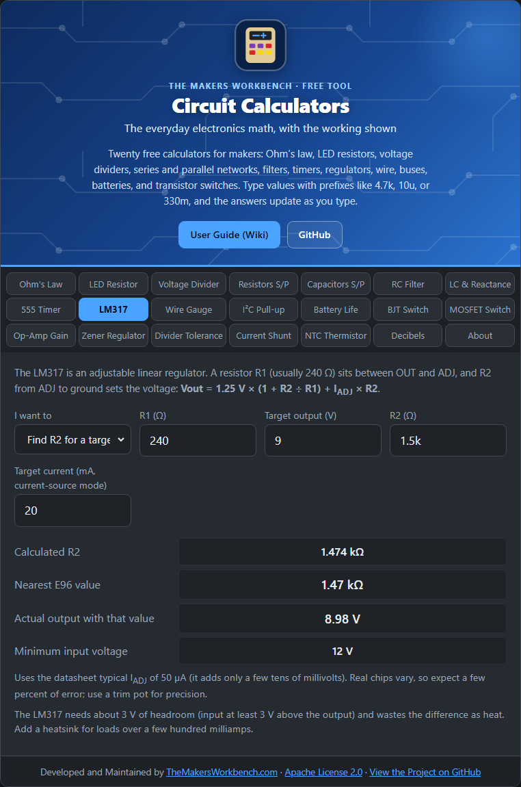

# LM317 Regulator

The LM317 is an adjustable voltage regulator. Give it a voltage higher than you need, add two resistors, and it delivers a steady output voltage that you choose.

## The theory

Inside the LM317 is a precise 1.25 V reference. The regulator adjusts its output until the voltage between its OUT and ADJ pins equals 1.25 V. A resistor R1 sits between OUT and ADJ, so a fixed current of 1.25 ÷ R1 flows through it. That same current flows through R2, which connects ADJ to ground, and adds its own voltage drop on top. So:

**Vout = 1.25 V × (1 + R2 ÷ R1) + Iadj × R2**

Iadj is a tiny current (about 50 µA typical) that flows out of the ADJ pin. It adds a small error, which this calculator includes.

Manufacturers usually recommend R1 around 240 Ω, because that keeps enough minimum load current flowing for the regulator to behave.

## How to use it

Choose what you want to find:

- **Find R2 for a target voltage**: enter R1 (240 Ω) and the voltage you want. You get the exact R2, the nearest standard E96 value, and the voltage that value actually gives.
- **Find the voltage from R1 and R2**: enter both resistors to see the output.

Both also show the **minimum input voltage**.

## Worked example

You want 9 V with R1 = 240 Ω. The exact R2 is about 1,474 Ω. The nearest E96 value is 1.47 kΩ, which gives about **8.98 V**.

## Things to watch

- **Dropout.** The input must be at least roughly 3 V above the output, and in practice more for large currents.
- **Heat.** A linear regulator wastes the voltage difference as heat: power = (Vin − Vout) × current. From 12 V down to 5 V at 0.5 A is 3.5 W, which needs a heatsink. If the difference is large, a switching converter is far more efficient.
- The reference and Iadj vary between chips, so the real output can be a few percent off. For precision use a trim potentiometer for R2 and measure the output.
- The LM317 needs input and output capacitors (see the datasheet), and it supplies up to about 1.5 A with proper heatsinking.

