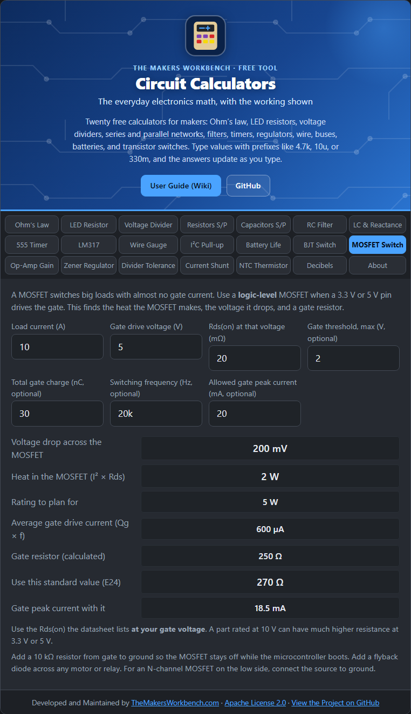

# MOSFET Switch

A **MOSFET** (metal-oxide-semiconductor field-effect transistor) is the modern way to switch a big load from a small signal. Unlike the [BJT switch](BJT-Switch), a MOSFET is controlled by **voltage** on its gate, so it draws almost no current once it has switched. That makes it ideal for motors, LED strips, heaters, and anything pulling several amps.

## The theory

An N-channel MOSFET has three pins: **gate** (control), **drain** (load side), and **source** (usually ground). When the gate voltage is high enough above the source, a channel opens and current flows from drain to source. When fully on, the MOSFET behaves like a very small resistor called **Rds(on)** ("drain-source on-resistance"), often a few milliohms to tens of milliohms. Two things matter:

- **Conduction loss**: the heat made while on, **P = I² × Rds(on)**, and the voltage it steals from the load, **V = I × Rds(on)**.
- **Gate drive**: the gate acts like a small capacitor. It needs a burst of charge (the **gate charge, Qg**) each time it switches. Average gate current is **Qg × switching frequency**, and a **gate resistor** limits the peak current from your pin.

A **logic-level** MOSFET is one whose Rds(on) is guaranteed at low gate voltages such as 4.5 V or 2.5 V. A standard MOSFET may need 10 V on the gate to turn fully on.

## Step by step

1. Open the **MOSFET Switch** tab.
2. In **Load current (A)**, type the current the load draws, for example `10`.
3. In **Gate drive voltage (V)**, type the voltage your pin gives, for example `5` or `3.3`.
4. In **Rds(on) at that voltage (mΩ)**, type the datasheet figure **measured at your gate voltage**, for example `20`. This is the number people most often get wrong.
5. In **Gate threshold, max (V)**, type the maximum threshold voltage from the datasheet (optional). If your drive voltage is not above it, the tool warns you.
6. In **Total gate charge (nC)** and **Switching frequency (Hz)**, type the datasheet Qg and your PWM frequency (optional) to see the average gate current.
7. In **Allowed gate peak current (mA)**, type how much your pin can supply at a peak (optional, for example `20`) to get a gate resistor.
8. Read **Voltage drop**, **Heat in the MOSFET**, and **Use this standard value (E24)** for the gate resistor.

## Worked example

Switch a 10 A load from a 5 V pin with a MOSFET rated 20 mΩ at 5 V. The drop is **0.2 V** and the heat is **2 W**, so it needs a heatsink or at least a larger package. At 20 kHz with 30 nC of gate charge the average gate current is **0.6 mA**. Limiting the peak to 20 mA suggests **270 Ω**, which gives about 18.5 mA.

## Things to watch

- **Use the right Rds(on).** A part listed at 5 mΩ at 10 V can be several times higher at 3.3 V.
- **Pulldown.** Put about 10 kΩ from gate to ground so the load stays off when the microcontroller is resetting.
- **Inductive loads.** Motors and relays need a flyback diode across them.
- **Low-side switching** (MOSFET between load and ground) is the simple case. Switching the positive side needs a P-channel MOSFET or a gate driver.
- Fast switching of big MOSFETs needs more gate current than a microcontroller pin gives. Use a gate driver.

