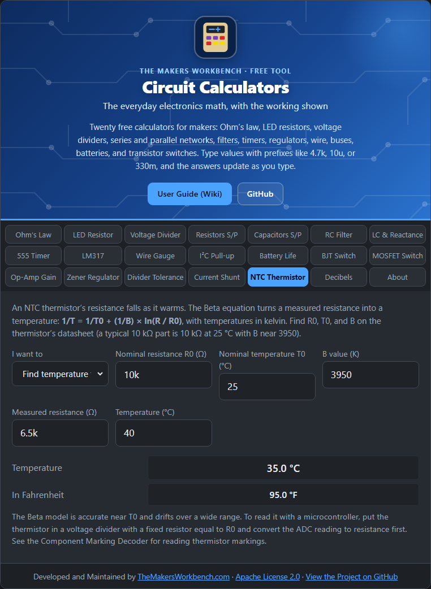

# NTC Thermistor

A **thermistor** is a resistor whose value changes with temperature. An **NTC** (negative temperature coefficient) thermistor gets **lower** in resistance as it warms. It is cheap and sensitive, which makes it a popular temperature sensor.

## The theory

The simplest model is the **Beta equation**:

**1 ÷ T = 1 ÷ T0 + (1 ÷ B) × ln(R ÷ R0)**

where T is the temperature in **kelvin** (°C plus 273.15), R0 is the resistance at the reference temperature T0 (usually 25 °C), and **B** (beta) is a constant from the datasheet, often around 3000 to 4500 K. Rearranged to find resistance from temperature: **R = R0 × e^(B × (1/T − 1/T0))**.

The Beta model is accurate near T0 and drifts over a wide range. For a wider range use the **Steinhart–Hart** equation or the datasheet table.

## Step by step

1. Open the **NTC Thermistor** tab.
2. In **I want to**, choose **Find temperature from resistance** or **Find resistance at a temperature**.
3. Type the thermistor's datasheet numbers: **Nominal resistance R0** (for example `10k`), **Nominal temperature T0** (`25`), and **B value** (`3950`).
4. For temperature from resistance, type the **Measured resistance**. For resistance from temperature, type the **Temperature**.
5. Read the **Temperature** (°C and °F) or the **Resistance**.

## Reading it with a microcontroller

Put the thermistor in a voltage divider with a fixed resistor (often equal to R0), measure the middle voltage with an ADC, convert that voltage back to the thermistor's resistance (see the [Voltage Divider](Voltage-Divider) page), then use this tab or the same formula in code. To identify a thermistor from its markings, see the [Component Marking Decoder](https://github.com/MakersWorkbench/component-marking-decoder).

## Worked example

A 10 kΩ, B = 3950 thermistor reads **6.5 kΩ**: the temperature is about **35.0 °C (95.0 °F)**. At exactly 25 °C it reads 10 kΩ.

## Things to watch

- Self-heating: too much current through the thermistor warms it and skews the reading. Keep the current small.
- Tolerance in R0 and B shifts readings, typically by a degree or so. Calibrate against a known thermometer for accuracy.

