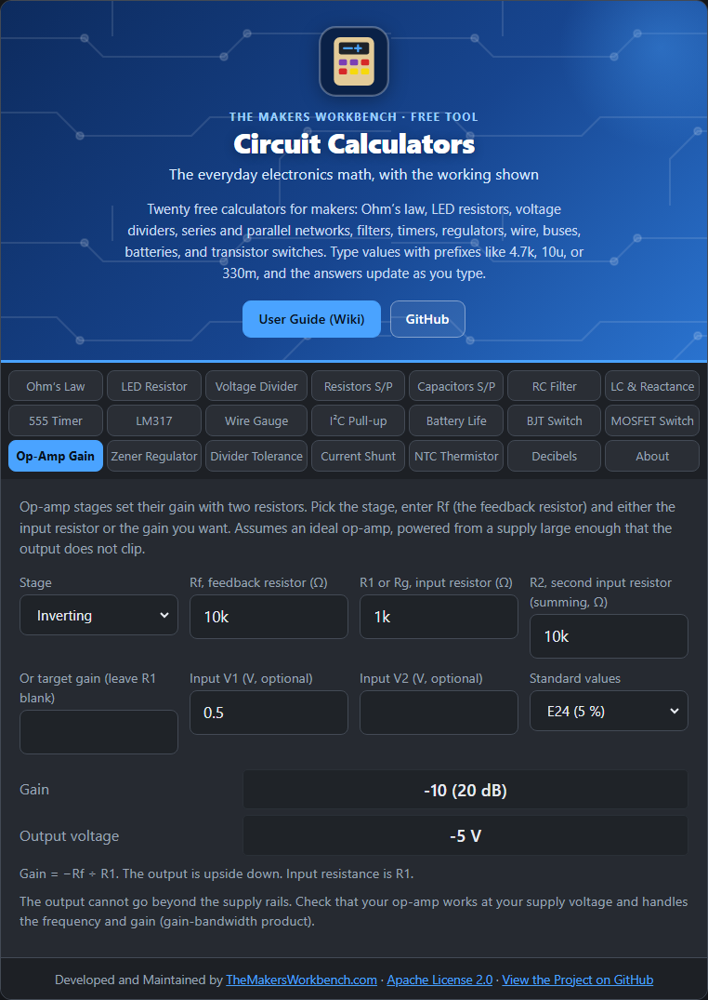

# Op-Amp Gain

An **operational amplifier** (op-amp) is a high-gain amplifier chip. By itself its gain is enormous and hard to control, so we wrap resistors around it (**feedback**) to set a precise, predictable gain.

## The theory

With negative feedback, the op-amp works to keep its two inputs at the same voltage. Using that one rule, the four common stages follow:

| Stage | Gain / output | Notes |
| --- | --- | --- |
| **Inverting** | Gain = −Rf ÷ R1 | Output is upside down. Input resistance is R1. |
| **Non-inverting** | Gain = 1 + Rf ÷ Rg | Never below 1. Very high input resistance. |
| **Summing** (inverting) | Vout = −Rf × (V1 ÷ R1 + V2 ÷ R2) | Mixes inputs, such as audio signals. |
| **Difference** | Vout = (Rf ÷ R1) × (V2 − V1) | With R2 = R1 and the ground resistor = Rf. |

Rf is the **feedback resistor** from the output back to the input. The output can never go beyond the supply voltages ("rails"), and every op-amp has a limit to how fast it can amplify (**gain-bandwidth product**).

## Step by step

1. Open the **Op-Amp Gain** tab.
2. In **Stage**, choose Inverting, Non-inverting, Summing, or Difference.
3. In **Rf, feedback resistor**, type the value, for example `10k`.
4. Either type the input resistor in **R1 or Rg**, for example `1k`, **or** clear that box and type a **target gain** in **Or target gain** (for example `11`) to have the tool find the resistor.
5. For a summing stage, type the second input resistor in **R2**.
6. Optionally type an input voltage in **Input V1** (and **V2** for summing or difference) to see the output.
7. Choose a **Standard values** series if you used a target gain.
8. Read **Gain** (shown in dB too), the nearest standard resistor, and **Output voltage**.

## Worked examples

- **Inverting**, Rf = 10 kΩ, R1 = 1 kΩ: gain **−10** (20 dB). A 0.5 V input gives **−5 V**, so your supply must reach at least ±5 V.
- **Non-inverting target 11** with Rf = 10 kΩ: Rg = Rf ÷ (11 − 1) = **1 kΩ**.
- **Summing** with three 10 kΩ resistors, V1 = 1 V, V2 = 2 V: **−3 V**.

## Things to watch

- The tool assumes an ideal op-amp. Check the datasheet for supply range, bandwidth, and whether the inputs and output can reach the rails ("rail-to-rail").
- High-value resistors add noise and make the input sensitive to leakage. 1 kΩ to 100 kΩ is a comfortable range.
- Single-supply circuits need a bias point (a mid-supply reference). This calculator does not model it.

