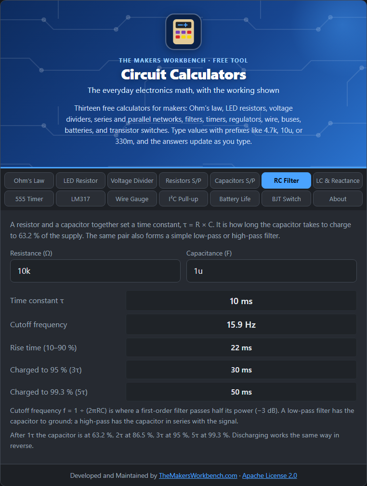

# RC Filter

A resistor and a capacitor together create a delay and a filter. This pair shows up in debouncing a switch, smoothing a signal, generating a delay, and shaping audio.

## The theory

A capacitor charges through a resistor. At first the capacitor is empty, so current flows freely. As it fills, its voltage rises and the current falls. The result is a smooth curve, not a straight line. The **time constant** sets the pace:

**τ (tau) = R × C**

With R in ohms and C in farads, τ comes out in seconds. After one τ the capacitor has charged to **63.2 %** of the supply. The curve continues: 86.5 % after 2τ, 95 % after 3τ, 98.2 % after 4τ, and 99.3 % after 5τ. By 5τ it is "done" for most purposes. Discharging is the mirror image, falling to 36.8 % after one τ.

## As a filter

The same pair also works as a filter. Signals change at different speeds. A capacitor passes fast changes more easily and slow ones less so. The **cutoff frequency** is where the filter passes half of the signal power, which is a 3 dB drop:

**fc = 1 ÷ (2π × R × C)**

- **Low-pass**: the signal goes through the resistor, and the capacitor goes to ground. Low frequencies pass, high frequencies are cut.
- **High-pass**: the signal goes through the capacitor, and the resistor goes to ground. High frequencies pass, low are cut.

A single RC stage is first-order: it rolls off at 20 dB per decade (a tenfold frequency increase) above the cutoff.

## How to use it

Enter the **resistance** and **capacitance** (`10k` and `1u`, for example). The calculator gives the time constant, the cutoff frequency, the 10 to 90 % **rise time** (2.2 × τ, a standard way to describe an edge), and the time to reach 95 % and 99.3 %.

## Step by step

Open the **RC Filter** tab. It opens with 10 kΩ and 1 µF.

1. In **Resistance (Ω)**, type the resistor value, for example `10k`.
2. In **Capacitance (F)**, type the capacitor value with a prefix, for example `1u` for 1 µF or `100n` for 100 nF.
3. Read **Time constant τ**. That is the time to reach 63 % charge.
4. Read **Cutoff frequency**. A signal at that frequency is cut in half in power. This is the number to use if you are building a low-pass or high-pass filter.
5. For a delay or debounce circuit, read the charge times at the bottom: **3τ** is 95 % charged and **5τ** is 99.3 %. Pick R and C so those times fit your needs.
6. Not getting the time you want? Change R or C and watch the numbers update. Doubling either one doubles the time.

## Worked example

R = 10 kΩ and C = 1 µF give **τ = 10 ms** and a cutoff of **15.9 Hz**. The capacitor is 95 % charged after 30 ms and 99.3 % after 50 ms. As a low-pass filter, anything much above 16 Hz is progressively attenuated.

## Things to watch

- A switch debounce circuit usually wants τ in the low milliseconds.
- The cutoff formula assumes the source impedance is small and the load is large. Real circuits shift it.
- Capacitor tolerance is wide, so expect the real cutoff to differ by 10 to 20 percent.

