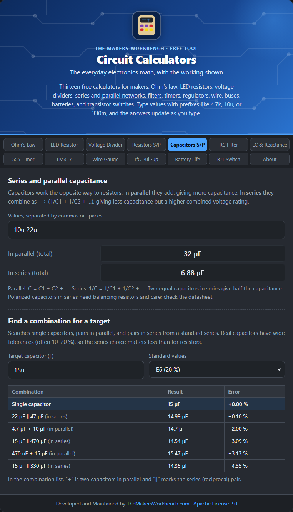

# Series and Parallel Capacitors

Capacitors combine by the opposite rules to resistors. If you remember how resistors combine, just swap "series" and "parallel".

## The theory

A capacitor stores charge on two plates. Capacitance (in farads, F) grows with plate area.

**In parallel**, the plates effectively add up in area, so the capacitances **add**:

**C = C1 + C2 + C3 + ...**

**In series**, the capacitors share the voltage and the effective plate separation grows, so the total is **smaller** than the smallest, using the reciprocal rule:

**1 ÷ C = 1 ÷ C1 + 1 ÷ C2 + ...**

Two equal capacitors in series give half the capacitance but can withstand about double the voltage.

## How to use it

Enter any number of values separated by spaces or commas, with prefixes: `10u 22u` or `100n 47n`. The calculator shows the parallel total and the series total.

To find a combination for a target, enter the target, pick a series (E6, E12, or E24), and read the top six matches. `+` means two capacitors in parallel and `∥` marks the series (reciprocal) pair.

## Step by step

Open the **Capacitors S/P** tab. It has two blocks.

**To add up capacitors you already have (top block):**

1. Click the box labeled **Values, separated by commas or spaces**.
2. Type the capacitor values with spaces between, using prefixes, for example `10u 22u` or `100n 47n`.
3. Read **In parallel (total)** if you will connect them side by side (capacitance adds), or **In series (total)** if you will connect them end to end (capacitance shrinks).

**To make a value you do not have (lower block):**

1. In **Target capacitor (F)**, type the value you need, for example `15u`.
2. In **Standard values**, choose the series you own (**E6** is typical for capacitors).
3. Read the table. A `+` means two capacitors in parallel and a `∥` marks a pair in series. The first row is the closest match, and the **Error** column shows how far off it is.

## Worked example

- **Parallel**: 10 µF + 22 µF = **32 µF**.
- **Series**: 10 µF and 22 µF in series = (10 × 22) ÷ 32 = **6.875 µF**.
- **Target 15 µF** from the E6 series: 10 µF + 4.7 µF = 14.7 µF is close, with an error of about −2 %.

## Things to watch

- **Voltage rating.** In parallel the combination is rated for the **lowest** voltage rating among the parts. In series the voltage divides, but it divides in inverse proportion to capacitance and the real leakage of each part, so unequal parts can overload one capacitor. Do not rely on series capacitors to double the voltage without balancing resistors.
- **Polarity.** Electrolytic and tantalum capacitors are polarized and must be connected the right way round. Putting them in series needs extra care and is usually avoided.
- Capacitors often have tolerances of 10 to 20 percent, so a precise combination is rarely worth chasing. Many designs just use decoupling values like 100 nF.

