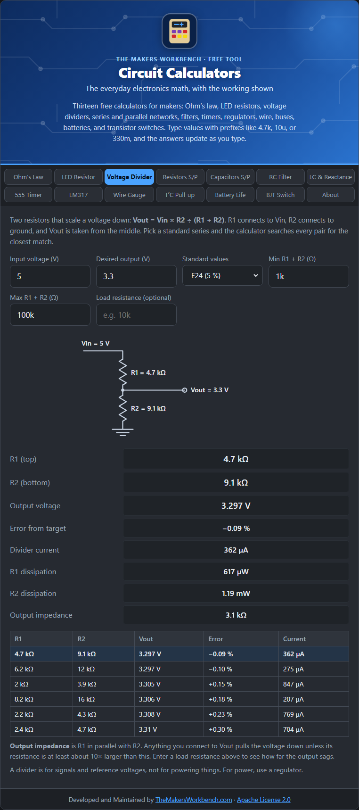

# Voltage Divider

A voltage divider turns a higher voltage into a lower one with two resistors. It is how you scale a sensor signal down for an analog input, set a reference voltage, or read a battery level.

## The theory

Put two resistors in series across a voltage Vin. The same current flows through both. That current is Vin ÷ (R1 + R2). The voltage across the bottom resistor R2 is that current times R2, so:

**Vout = Vin × R2 ÷ (R1 + R2)**

R1 connects to the input and R2 connects to ground. You take the output from the point between them. The output is simply Vin multiplied by the **fraction** R2 ÷ (R1 + R2). Equal resistors halve the voltage. R2 twice as big as R1 gives two thirds.

## How to use it

1. Enter the **input voltage** and the **desired output voltage**.
2. Choose a **standard series** (E12, E24, E48, or E96). Higher numbers find closer matches but need tighter-tolerance parts.
3. Set the allowed range for **R1 + R2** (the total). This controls how much current the divider wastes. With 5 V across 10 kΩ total the divider draws 0.5 mA. The default range is 1 kΩ to 100 kΩ.
4. Optionally enter a **load resistance**, meaning whatever the output feeds, to see how the output sags under load.

## Reading the results

The calculator tries every R1 and R2 pair from your series inside the range and lists the six closest to your target. The best one is shown in detail:

- **R1** (top) and **R2** (bottom)
- **Output voltage** and **Error from target** as a percentage
- **Divider current**: the current that flows continuously, which is the cost of the divider
- **R1 and R2 dissipation**: the heat in each resistor (almost always tiny)
- **Output impedance**: R1 in parallel with R2. This is how "stiff" the output is
- **Output with load**: Vout when your load resistance is connected

The drawn schematic shows which resistor goes where.

## The loading problem

The formula assumes nothing draws current from the output. A real load changes that. The load sits in parallel with R2, lowering the bottom resistance and dragging Vout down. As a rule, the load resistance should be at least **10 times** the output impedance, or you should buffer the output (with an op-amp, for example). Enter a load resistance to see exactly how much it sags.

## Worked example

Scale 5 V to about 3.3 V. With E24 values the calculator finds **R1 = 4.7 kΩ, R2 = 9.1 kΩ**, giving **3.297 V** (−0.09 % error) with 362 µA of divider current. Now add a 10 kΩ load: R2 in parallel with 10 kΩ is about 4.76 kΩ, and the output drops to roughly **2.52 V**. That is the lesson of loading, and why a divider is not a power supply.

## Things to watch

- Do not use a divider to power anything. For power use a regulator (see [LM317](LM317-Regulator)).
- Lower resistances load the output less but waste more current. Higher resistances save current but are more easily disturbed by loads and noise. 10 kΩ total is a common middle ground.
- Resistor tolerance matters: two 1 % resistors can still move the output by about 1 %.

