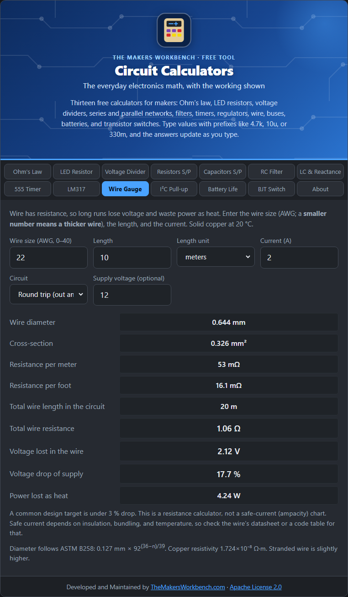

# Wire Gauge and Voltage Drop

Wire is not a perfect conductor. It has resistance, so a long, thin run loses voltage and wastes power as heat. This matters for LED strips, motors, and anything low-voltage that draws real current.

## The theory

**AWG** (American Wire Gauge) is the common sizing system. The number gets **smaller as the wire gets thicker**: 10 AWG is thick, 30 AWG is hair-thin. Each step down in number is about 12.3 % thicker and every 3 steps roughly halves the resistance. The diameter follows a defined formula (ASTM B258):

**diameter (mm) = 0.127 × 92^((36 − n) ÷ 39)**

The wire's resistance comes from the same equation used for any conductor: **R = ρ × L ÷ A**, where ρ is the resistivity of copper (1.724 × 10⁻⁸ Ω·m at 20 °C), L is length, and A is the cross-section area. A thicker wire has a larger A and so less resistance.

Voltage lost in the wire is Ohm's law again: **drop = I × R**, and the wasted power is **I² × R**.

## How to use it

1. Enter the **AWG size**.
2. Enter the **length** and choose meters or feet.
3. Enter the **current** the load draws.
4. Choose **Round trip** if the current goes out and comes back through the same length of wire (the usual case with a two-wire supply), or **One way** if only one conductor counts.
5. Optionally enter the **supply voltage** to see the drop as a percentage.

## Reading the results

You get the wire diameter and cross-section, resistance per meter and per foot, the total wire length counted, the total resistance, the voltage lost, the percentage of the supply that loses, and the power wasted as heat.

## Step by step

Open the **Wire Gauge** tab. It opens with 22 AWG, 10 m, and 2 A.

1. In **Wire size (AWG, 0–40)**, type the gauge printed on your wire. A smaller number is thicker wire. If you only know the diameter, try a few sizes until **Wire diameter** matches.
2. In **Length**, type how long the run is. Count one side only (the distance from the supply to the load).
3. In **Length unit**, choose **meters** or **feet**.
4. In **Current (A)**, type the current the load draws, for example `2`.
5. In **Circuit**, leave **Round trip (out and back)** for a normal two-wire supply, since current travels the length twice. Choose **One way only** just for a single conductor.
6. In **Supply voltage (optional)**, type your supply, for example `12`, so you can see the loss as a percentage.
7. Read **Voltage lost in the wire** and **Voltage drop of supply**. If the percentage is more than about 3 %, choose a thicker wire (a smaller AWG number) and check again.
8. **Power lost as heat** tells you how much energy is wasted in the wire itself.

## Worked example

A 12 V device draws 2 A, 10 m away, on 22 AWG wire (round trip means 20 m of wire). Resistance is about 1.06 Ω, so the drop is **2.1 V, which is 17.6 % of the supply**, and 4.2 W is wasted as heat in the wire. Too much. Change to 16 AWG and the drop falls to about **0.53 V (4.4 %)**. A common design target is to keep the drop under about 3 %, and use a still thicker wire.

## Things to watch

- This tab calculates resistance and voltage drop. It is **not** an ampacity chart. How much current a wire can safely carry depends on insulation, bundling, and temperature. Check the wire's datasheet or an electrical code table.
- Stranded wire has slightly more resistance than solid wire of the same gauge.
- Higher temperature raises copper resistance by about 0.4 % per °C.
- Low voltages hurt most: a 1 V drop on a 5 V line is 20 %, but on 230 V it is nothing.

