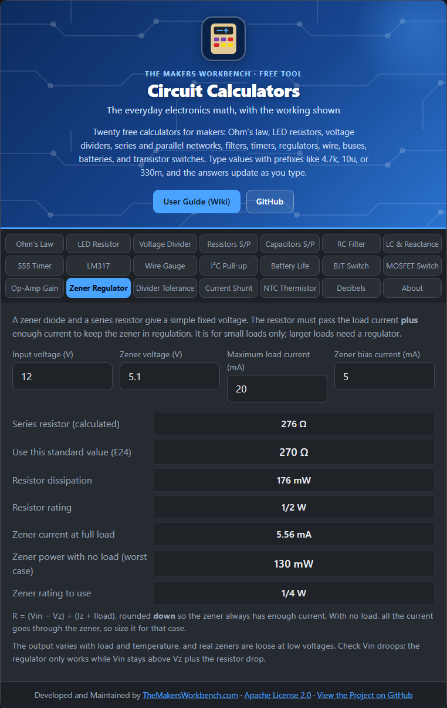

# Zener Regulator

A **zener diode** conducts backwards once the voltage reaches a set value (its zener voltage, Vz) and then holds that voltage steady. With a series resistor, it makes a simple fixed-voltage supply, ideal for small loads and reference voltages.

## The theory

Connect a resistor from the input to the zener, with the zener to ground, and take the output across the zener. The resistor carries the load current **plus** the zener's own current. The zener needs a minimum bias current (called Iz, often a few milliamps on the datasheet) to hold its voltage.

**R = (Vin − Vz) ÷ (Iz + Iload)**

Two cases set the part ratings:

- **Full load**: the zener carries only its bias current. The resistor power is **I² × R**.
- **No load**: all the current goes through the zener, so its power is **Vz × (Vin − Vz) ÷ R**. This is the worst case for the zener, so size it for this.

The resistor is rounded **down** to a standard value so the zener always gets at least its bias current.

## Step by step

1. Open the **Zener Regulator** tab.
2. In **Input voltage (V)**, type the supply, for example `12`. It must be higher than the zener voltage.
3. In **Zener voltage (V)**, type the diode's rating, for example `5.1`.
4. In **Maximum load current (mA)**, type the most current your load will draw, for example `20`.
5. In **Zener bias current (mA)**, type the datasheet test current, for example `5`.
6. Read **Use this standard value (E24)** (the resistor), its **Resistor rating**, and **Zener rating to use**.

## Worked example

12 V in, a 5.1 V zener, 20 mA load, 5 mA bias. The exact resistor is 276 Ω, so use **270 Ω**. The resistor dissipates about 0.18 W, so a **1/2 W** part. With no load the zener carries 25.6 mA and dissipates about **0.13 W**, so a **1/4 W** zener is the minimum.

## Things to watch

- The output moves with load and temperature, and low-voltage zeners are soft. For anything precise use a regulator or a reference chip like the TL431.
- If Vin droops close to Vz, regulation is lost.
- A zener is wasteful: the resistor and zener burn power continuously. Use it for tiny loads.

